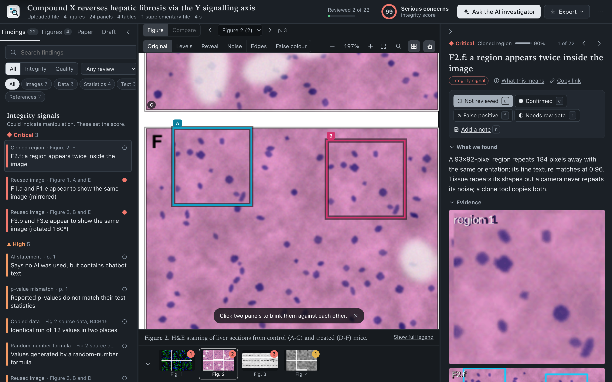
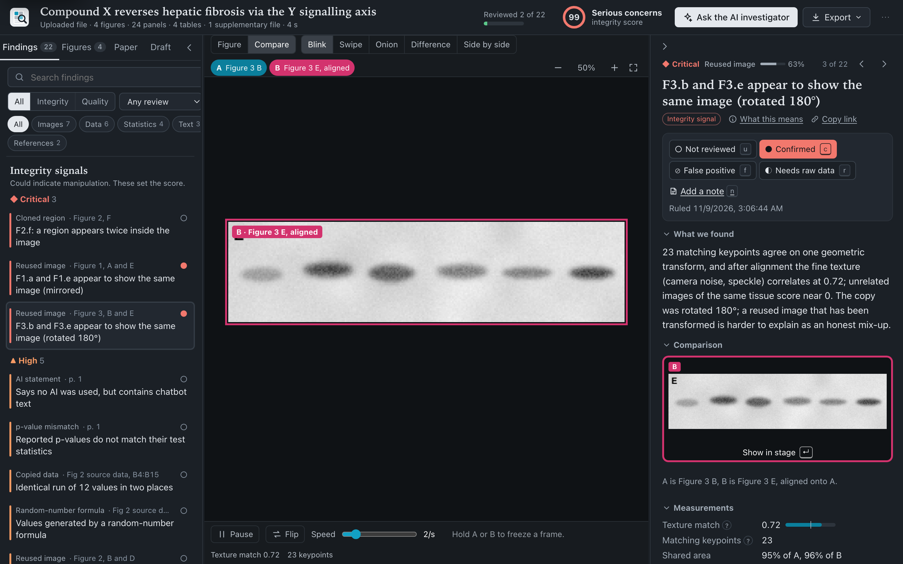
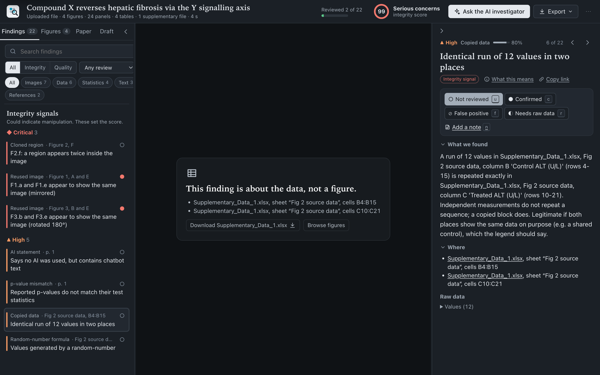

# Paper Inspector

**Paste a DOI. Get the paper inspected.**

Paper Inspector fetches a scientific paper with its figures, data and supplementary files. It then checks what a
careful reviewer or research-integrity sleuth would look for: reused or edited images, copied or impossible
numbers, references that do not exist, and quieter problems that authors often miss. Every flag comes with its
evidence, so a person can judge it in seconds. An optional AI investigator, using a model of your choice, reviews
the flags the way an experienced sleuth would and drafts a careful comment asking for the raw data.

It runs on your own computer: a local engine with a web app and a native Mac app.



| Blink comparator | Data findings point to the exact cells |
| --- | --- |
|  |  |

## Why

Thousands of papers are retracted every year for duplicated images, fabricated data or references that do not
exist. That often happens years after other scientists, doctors and patients have relied on them. Most of these
problems are found by a few volunteers working by hand. Generative AI adds new problems: invented references,
hidden prompts aimed at AI reviewers, and chatbot text pasted into papers. Paper Inspector puts the sleuth's
toolkit one paste away for reviewers, editors, integrity officers, students, and authors checking their own work.

## What it checks

| Area | Integrity signals (set the risk score) | Quality notes (listed, not scored) |
|---|---|---|
| **Images** (main figures and every image in the supplements) | the same picture used twice, also mirrored, rotated, rescaled, stretched or cropped; overlapping fields of view; regions cloned inside one image, also mirrored or turned 180°; a blot shown again as its negative; a band row (such as a loading control) reused between blots; one embedded picture placed twice in the PDF; splice seams in blots; painted patches with no camera noise; identical charts | editing software recorded in image files; every duplicate labelled with its Bik category (I–III) |
| **Data** (tables in the article, spreadsheets, CSV, Word files, PDFs in the supplements) | runs of values copied between rows, columns, sheets or files; a run that is another run plus or times a constant; values made with `RAND()`; last digits far from uniform; precise values repeating; one SD for every group; one column typed in two fonts | gene symbols turned into dates by Excel; percentages over 100 and p-values over 1; hidden sheets, rows and columns; typed numbers inside a formula column; rows moved (Excel's calculation record); mean/SD columns that do not match their replicates; mixed precision; Benford first digits; linked workbooks; supplementary files made after publication |
| **Statistics** (text) | p-values that cannot follow from their test statistic (statcheck-style); means impossible for the sample size (GRIM); SDs impossible for whole-number data (GRIMMER); confidence intervals that contradict their p-values; trial baseline tables too similar or too different (Carlisle) | percentages that do not match their counts; p = 0.000; estimates outside their own interval; degrees of freedom larger than n allows; SD and SEM mixed up; correlations, R², alpha or AUC above 1 |
| **Text** | hidden instructions to AI reviewers (white, microscopic or off-page text, invisible Unicode tags); tortured phrases; "no AI was used" next to chatbot text | chatbot boilerplate; invisible characters |
| **References** (each one looked up in OpenAlex and Crossref) | references nobody can find; one outside author cited again and again; references deposited with the publisher but not printed | DOIs that do not exist; a cited DOI that points to a different paper; retracted references; works cited after their retraction; expressions of concern; high self-citation; off-topic, uncited and duplicated entries |
| **Reporting** | | misidentified cell lines (ICLAC register and Cellosaurus); trial numbers in an impossible format, not found, or registered late; trials without a registration number; no ethics approval; data "available on request"; data accessions (GEO, SRA, BioProject) that are not public; "data not shown"; SEM with n = 2–3; figures cited but missing |
| **Publication record** | retraction; expression of concern; acceptance within days of submission | corrections; a near-identical title by the same authors; authors' other retractions; special-issue papers |

Integrity signals could mean manipulation. Quality notes are honest problems and missing information. Only
integrity signals feed the 0–100 risk score. The app explains every check in plain words, including its common
innocent causes and what to ask the authors.

## The AI investigator

The detectors are fast but literal. They cannot tell that a magnified inset is meant to repeat its parent panel.
The investigator is a tool-using agent. It can list the findings, view the evidence, open whole figures with their
legends, switch a panel into contrast-stretched, "reveal" or noise views, ask the engine to align any two panels,
and search the methods and legends. It then rules on each finding (confirmed, likely, unclear or false positive),
adds anything the detectors missed, and drafts a comment that describes what is visible and asks for raw data.

- **Any model.** Claude runs through the Anthropic SDK. GPT, Gemini, DeepSeek, Qwen, Kimi, Mistral and Grok, or
  anything else OpenAI-compatible, run through one client. A local Ollama or LM Studio model needs no key and sends
  nothing off the computer.
- **Prompt-injection safe by design.** Text from the paper reaches the model only inside tagged blocks marked as
  untrusted. Text addressed to "reviewers" or "AI systems" is reported as a finding, never followed.
- **Optional.** Everything else works without any AI. The measurements are deterministic computer vision and
  statistics; the model reviews them and explains them.

## Using it

- **Paste anything**: a DOI, PMID, PMCID, arXiv ID, article link, title, or a whole list (also BibTeX or RIS) to
  queue a batch.
- **Or drop files**: a PDF with its spreadsheets, Word files and archives (for paywalled papers you already have).
- **Triage with the keyboard**: `j`/`k` to move, `c` confirmed, `f` false positive, `r` needs raw data, `n` note,
  `⌘K` for the command palette. Rulings are saved and survive a re-scan.
- **Export**: findings as CSV, Excel or PDF; an evidence pack (ZIP with a SHA-256 manifest); letter templates that
  ask the authors or the journal for raw data.

## Run it

Needs Python 3.11 or newer and Node 18 or newer.

```bash
python3 -m venv .venv && ./.venv/bin/pip install -e ".[ai]"
(cd web && npm install && npm run build)       # the engine serves the built web app
./.venv/bin/paperinspector serve               # then open http://127.0.0.1:8765
```

Command line:

```bash
./.venv/bin/paperinspector doi 10.1371/journal.pbio.1002106
./.venv/bin/paperinspector scan paper.pdf -s data.xlsx
./.venv/bin/paperinspector batch dois.txt
./.venv/bin/paperinspector demo demo.pdf       # a synthetic paper with planted problems
```

Mac app: `./mac/build_app.sh`, then open `mac/build/Paper Inspector.app`. It starts the same engine.

Optional: `brew install tesseract`, which masks text printed inside images and removes a class of false alarms.

Data stays in `~/.paperinspector` (set `PAPERINSPECTOR_HOME` to move it). The engine answers only local requests.
To use the AI investigator, choose a model and paste its key in Settings; the key is saved only in a local file
that only you can read.

## How it works

- **Fetching.** From a DOI: Crossref and OpenAlex (metadata, references, retraction notices), the PubMed Central
  cloud dataset (PDF, JATS XML with machine-readable tables, original figure files, supplementary files), Europe
  PMC, bioRxiv/medRxiv, arXiv, publisher figure endpoints and the landing page's own metadata. Each source reports
  what it found or why it failed. Nothing behind a paywall is bypassed.
- **Images.** Figures are cut into panels and typed (blot, micrograph, photo, chart). SIFT keypoints of every panel
  and its mirror image go into one nearest-neighbour index. Candidate pairs are verified with RANSAC, and the
  aligned pixels must share their fine texture: camera noise and speckle survive brightness edits, while two honest
  photos of the same tissue do not correlate. Burned-in text, charts, flat fills and halftone patterns are excluded
  because they repeat by design.
- **Blink comparator.** Any two panels can be aligned, then flickered, swiped, onion-skinned or differenced (with
  gain). This is the way astronomers found Pluto, and the way image sleuths present reuse.

## How well it works

- **Synthetic benchmark** (`tools/bench.py --n 4 --seed 99`, held-out draw of 252 papers): realistic
  fluorescence, histology, phase-contrast, photo and blot figures laid out as real PDFs, each with one planted
  manipulation. **92.0%** of planted manipulations found (195/212). **0 of 40** clean papers and 0 of 212
  manipulated papers had a false alarm. Weakest areas: subtle blot splices and cloned patches.
- **Real papers** (`tools/real_cases.py` and `tools/real_eval.py`): retracted and non-retracted PLOS ONE papers,
  scored against what each retraction notice says. 12 retracted and 12 non-retracted PLOS ONE papers. Of the 7 retracted for image problems, the
  figure the notice names was flagged in 4; the misses are band-level problems inside one blot (flipped bands, lane
  splices). Median risk score **44** for retracted papers against **0** for non-retracted ones; 7 of 12 retracted and
  3 of 12 non-retracted papers scored 40 or more. The three flagged controls carry strong image flags that a person
  should look at: controls are not guaranteed clean. Real figures are much harder than synthetic ones, so treat the
  score as triage, not judgement.
- **Tests**: about 500 Python tests (detectors, data, statistics, text, references, inputs, HTTP API and
  security) and 36 Swift tests. No test uses the network.

A screen finds candidates, not verdicts. Every flag needs a person to look at it, and many have innocent
explanations.

## Repository

| Path | What |
| --- | --- |
| `engine/paperinspector/` | Python engine: fetching, every check, the local API and the command line |
| `web/` | Web app (React, TypeScript, Vite) |
| `mac/` | Mac app (SwiftUI) |
| `tests/` | Python tests |
| `tools/` | Benchmarks and asset scripts |
| `docs/` | Handover guide, roadmap, submission write-up, demo script |

New to the code? Start with [docs/HANDOVER.md](docs/HANDOVER.md).

## Credits

Detection ideas come from the public work of research-integrity investigators and tools: Elisabeth Bik, Sholto
David, Data Colada, the Problematic Paper Screener, statcheck, GRIM and GRIMMER, and Carlisle's baseline test. Cell
line data comes from the ICLAC register (downloaded at run time, not redistributed) and Cellosaurus. Libraries:
PyMuPDF, OpenCV, NumPy, SciPy, FastAPI, httpx, openpyxl, python-docx, React, Vite and SwiftUI. Data: Crossref,
OpenAlex, PubMed Central, Europe PMC, bioRxiv, arXiv, NCBI E-utilities and ClinicalTrials.gov. Claude Code was used
as an AI coding assistant.

MIT licence.
